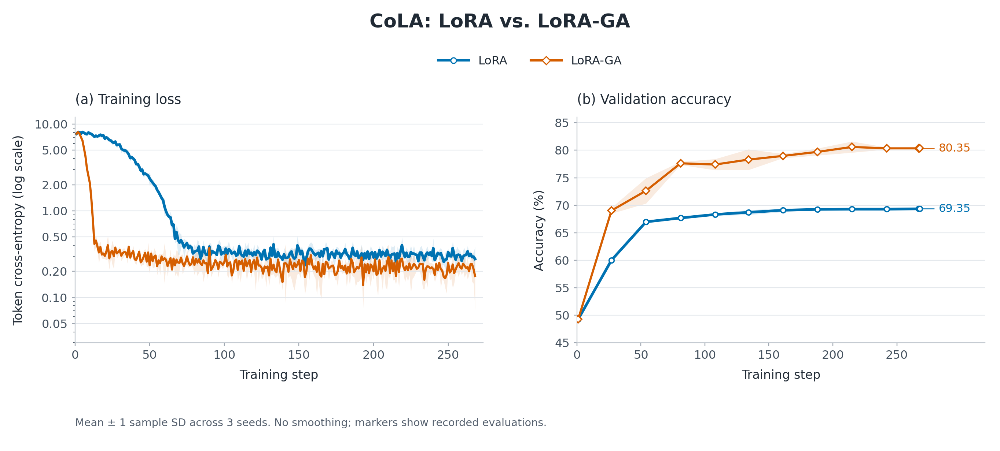
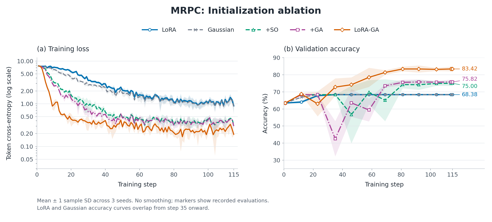
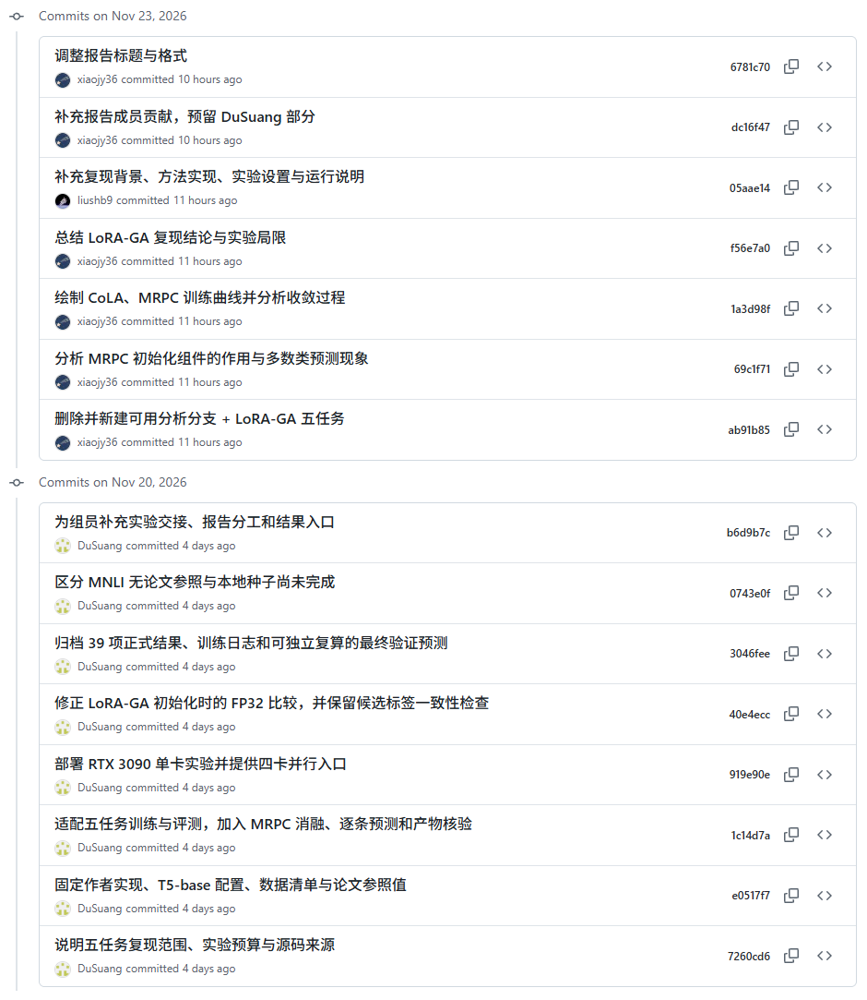

# 自然语言处理课程期中作业：LoRA-GA 复现报告

**小组成员**　杜轩、肖金洋、刘盛邦

## 1. 复现目标与范围

本组选取 Shaowen Wang、Linxi Yu 和 Jian Li 发表于 NeurIPS 2024 的论文《LoRA-GA: Low-Rank Adaptation with Gradient Approximation》[1]，复现其中基于 T5-base 的 GLUE 分类实验。

全参数微调需要更新模型的全部参数，训练时还要保存对应的梯度和优化器状态，资源开销较大。LoRA 冻结预训练权重，只训练两个低秩矩阵来表示权重增量，从而减少可训练参数及相关存储开销。但低秩参数化也改变了权重的更新方式，在相同训练预算下，效果可能落后于全参数微调。

LoRA-GA 从初始化入手改善这一问题。普通 LoRA 随机初始化一个矩阵、将另一个置零；LoRA-GA 则先用少量训练样本估计梯度，再利用梯度方向和尺度调整初始化两个矩阵，使训练初期的权重更新更接近全参数微调的梯度方向。本文关注这种初始化能否提高有限训练预算下的效果，以及梯度方向和尺度调整分别起到什么作用。

本次主实验对应论文表 1，比较 T5-base 在 MNLI、SST-2、CoLA、QNLI、MRPC 上的 LoRA 与 LoRA-GA，每种配置运行三个种子，共 30 次训练。消融实验对应附录表 9 的 MRPC 列，比较五种初始化；复用主实验中的 LoRA 和完整 LoRA-GA 结果后，额外增加 9 次训练，合计 39 次。本次以普通 LoRA 为同条件基线，未安排全参数微调实验。

除最终准确率外，我们还分析 MRPC 的逐条预测，并绘制 CoLA、MRPC 的训练曲线，观察不同初始化如何影响分类结果和训练过程。

## 2. 方法原理与复现实现

### 2.1 LoRA-GA 方法原理

普通 LoRA 冻结预训练权重 $W_0$，只训练低秩矩阵 $A$、$B$。设 $r$ 为适配器的秩，$s$ 为缩放系数，该层的有效权重为

$$
W_{\mathrm{eff}}=W_0+sBA .
$$

普通 LoRA 随机初始化 $A$，将 $B$ 置零，因此模型从原预训练权重开始训练。但 $B_0=0$ 也使第一步中 $A$ 的损失梯度为零，$B$ 的更新方向又受随机矩阵 $A_0$ 影响。论文提出的 LoRA-GA [1] 利用训练数据选择初始方向，使低秩更新在第一步就能近似全参数微调梯度的主要分量。

本组使用训练集原始顺序中的前 $K=8$ 条样本。对每个目标层，在预训练权重处逐条计算序列平均损失的梯度，再取样本平均：

$$
\widehat G=\frac{1}{K}\sum_{i=1}^{K}\nabla_W\mathcal L(x_i;W_0).
$$

对 $\widehat G$ 做低秩奇异值分解（SVD），将按奇异值降序排列的左右奇异向量分别记为 $u_j$、$v_j$。本组取 $r=8$，用第 1–8 个右奇异向量构造 $A_0$，用第 9–16 个左奇异向量构造 $B_0$：

$$
A_0=c[\,v_1,\ldots,v_r\,]^\top,\qquad B_0=c[\,u_{r+1},\ldots,u_{2r}\,].
$$

在论文的一阶梯度下降分析中，更新 $B$ 使有效权重沿 $A_0$ 的行空间变化，更新 $A$ 则利用 $B_0$ 的列空间。两者选取互补的方向，合起来就能近似校准梯度中前 $2r$ 个奇异方向上的分量。完整 LoRA-GA 按输出维度 $d_{\mathrm{out}}$ 设置因子幅度 $c=d_{\mathrm{out}}^{1/4}/\sqrt{\gamma}$，并使用 $s=\alpha/\sqrt r$ 控制更新尺度。由于 $B_0A_0$ 非零，安装适配器时还需从基座扣除初始增量：

$$
C=W_0-sB_0A_0,\qquad C+sB_0A_0=W_0 .
$$

这样，各方法从相同的有效权重出发。梯度估计只在初始化时执行，正式训练冻结补偿后的 $C$，只更新 $A$、$B$。上式在精确算术下成立，FP32 的数值检查见 2.3 节。

### 2.2 核心方法实现与实验流程

代码基于作者发布的 LoRA-GA 实现改写，本组采用作者仓库 `Outsider565/LoRA-GA` 的提交 `c4cd5372`。本组将五个 GLUE 任务接入同一训练入口。每次运行先加载 T5-base 和对应任务数据，在注意力与前馈层选择目标投影，再按所选方法安装适配器。只有 +GA 和完整 LoRA-GA 需要读取校准样本并做 SVD。各方法随后使用相同的训练与评测流程，具体训练预算见第 3 章。

| 实现环节 | 作者代码或依据 | 本组代码与具体工作 |
|---|---|---|
| 梯度估计与初始化 | `run_exp.py` 中的 `estimate_gradient`、`reinit_lora_modules` | `adapters.py` 对单样本梯度取平均，统一实现五种初始化与权重补偿。 |
| 模型与训练 | `utils.py` 中的 `train_text_to_text_model` | `glue_train.py` 组织适配器训练，保存初始与最终适配器，并在重新加载后核对输出。 |
| 数据与评测 | `data.py` 的任务映射和 `utils.py` 的首位置评分 | `glue_data.py` 编码输入与标签，在解码首位置比较全部候选标签分数，支持 MNLI 三分类并保存逐条预测。 |
| 实验管理 | 本组新增 | `suite.py` 按任务、方法和种子启动训练，管理重试与结果汇总，记录每次运行的配置、日志和完成清单。 |
| 正确性检查 | 作者的初始化与标签编码实现 | 使用单元测试核对初始化、损失和评测逻辑。数值对照见第 2.3 节，归档预测的复算方法见第 6 章。 |

五种初始化共用同一适配器结构。下表中的尺度调整包含两项操作：两个初始因子各乘以 2.1 节中的 $c$，并将前向缩放系数 $s$ 从 $\alpha/r$ 改为 $\alpha/\sqrt r$。

| 方法 | 初始化方向 | 尺度调整 |
|---|---|---|
| LoRA | 随机初始化 $A$，$B$ 置零 | 无 |
| Gaussian | $A$、$B$ 均从高斯分布采样 | 无 |
| +SO | 与 Gaussian 相同 | 有 |
| +GA | 两组梯度奇异向量 | 无 |
| LoRA-GA | 与 +GA 相同 | 有 |

Gaussian 在非方形矩阵上的方差按论文表 3 设置。若基座权重有 $m$ 行、$n$ 列，本组对 $A$、$B$ 分别使用方差 $1/m$、$1/n$；作者公开代码的 Gaussian 分支将这两个维度反向对应。两种写法可分别在本组 `adapters.py` 的 `initialize_factors` 和作者 `run_exp.py` 的 `reinit_lora_modules` 中核对。

### 2.3 关键技术问题与正确性验证

校准和正式训练都涉及平均损失，但平均的单位不同。校准阶段要让八条样本对梯度各贡献八分之一，因此先对每条序列内部的损失求平均，再平均八个梯度。正式训练则沿用作者的编码与损失定义：一个逻辑批次按最长目标标签补齐，填充位置保留 PAD 的词表编号，也计入交叉熵。若各微批独立补齐，或把 PAD 改成损失函数忽略的标签，就会改变参与平均的位置。

这个差别在两条 MNLI 样本上即可观察到。忽略 PAD 时只有 7 个目标位置参与损失，作者实现计入 10 个位置，两者的损失分别为 8.68025 和 8.66179。本组先补齐整个逻辑批次，再切分微批，每个微批按其目标位置数占全批的比例累积梯度。我们在关闭 dropout 的同一微型 T5 上，用 FP64 对照作者训练路径的整批损失与全部可导参数的梯度。

| 技术问题 | 修复或检查方式 | 验证结果 |
|---|---|---|
| 长标签在校准时权重偏大 | 对每条样本单独反传，等权平均所得梯度 | 两条长度为 1、3 的合成序列，按长度加权得到 $[0.5,3]$，修正后逐元素等于预期的 $[1,2]$（测试用例 `test_singleton_mean`）。 |
| 微批拆分改变训练目标 | 整批补齐后切片，与作者整批计算逐项对照 | 32 条按 8 条拆分，损失绝对误差为 $1.78\times10^{-15}$，梯度最大绝对误差为 $7.22\times10^{-16}$。19 条尾批按 8、8、3 拆分，两项误差分别为 0 和 $4.44\times10^{-16}$。逐项误差记录在 `loss_protocol.json` 中。 |
| FP32 权重补偿引入舍入误差 | 对完整 LoRA-GA，将全词表 logits 的相对容差由 $10^{-5}$ 调为 $1.5\times10^{-5}$；候选标签保留 $10^{-5}$，两处绝对容差均为 $2\times10^{-4}$ | SST-2 的 LoRA-GA 运行（种子 2，`init.json`）中，192 个投影在权重补偿后的最大相对误差为 $2.97\times10^{-8}$。4 条固定验证样本在初始化前后的候选预测均一致。 |

FP64 对照验证的是微批拆分前后的训练目标和梯度。正式训练使用 FP32 且启用 dropout，随机掩码仍会影响实际轨迹。FP32 容差调整仅用于训练前的输出检查；回归测试 `test_fp32_initial_probe` 验证了两种会触发失败的情形：候选类别翻转，或唯一最大值变成并列。

## 3. 实验设置

实验以普通 LoRA [2] 为基线，在 T5-base [3] 上复现 GLUE [4] 的五个分类任务。每个任务训练一轮，种子为 0、1、2。

| Task | Training samples | Validation samples | Training steps |
|---|---:|---:|---:|
| MNLI | 392,702 | 9,815 matched | 12,272 |
| SST-2 | 67,349 | 872 | 2,105 |
| CoLA | 8,551 | 1,043 | 268 |
| QNLI | 104,743 | 5,463 | 3,274 |
| MRPC | 3,668 | 408 | 115 |

适配器安装在注意力层的 q、k、v、o 和前馈层的 wi、wo，共训练 3,244,032 个参数。主要配置如下：

| Setting | Value |
|---|---|
| Rank / Alpha | 8 / 16 |
| Training / Evaluation batch size | 32 / 32 |
| Optimizer / Learning rate | AdamW / 1e−4 |
| Learning-rate schedule | Cosine, 3% warmup |
| Weight decay / Gradient clipping | 0 / 1 |
| Maximum input length (training and evaluation / calibration) | 128 / 1,024 tokens |
| Calibration samples / Gamma | 8 / 16 |
| Precision | FP32, TF32 disabled |

正式实验在 RTX 3090 上运行，使用 Python 3.11.18、PyTorch 2.3.0+cu121 和 Transformers 4.40.2。

**评估口径与公平性。** 同一任务、同一种子下，各方法共用训练样本顺序、更新步数和验证时点，统一取完整一轮的最后一步计算配对差值。为对照论文表 1，五项任务均报告验证集准确率，包括 CoLA。各任务报告三个种子的均值和样本标准差，五任务平均按任务等权计算。

与作者公开实现对照时，有两处评估细节会影响数值比较。其一，作者脚本默认按验证损失选取检查点，本组固定取最后一步。原论文未给出每个种子最终选中的步数。其二，作者的公开评分函数比较解码首位置的正确标签和另一个标签，适用于二分类。本组在该位置比较所有候选标签，使同一规则也能覆盖 MNLI 的三个类别。MNLI 沿用作者选取的 matched 验证集计入主表，mismatched 单独报告。作者的评分函数为 `compute_metrics`，本组对应实现为 `evaluate_split`。

## 4. 实验结果与分析

### 4.1 五任务主实验

**Table 1. GLUE accuracy (%) on T5-base.**

<!-- main-table:start -->

| Method | MNLI-m | SST-2 | CoLA | QNLI | MRPC | Avg. |
|---|---:|---:|---:|---:|---:|---:|
| LoRA (Paper) | 85.30 ± 0.04 | 94.04 ± 0.11 | 69.35 ± 0.05 | 92.96 ± 0.09 | 68.38 ± 0.01 | 82.08* |
| LoRA-GA (Paper) | 85.70 ± 0.09 | 94.11 ± 0.18 | 80.57 ± 0.20 | 93.18 ± 0.06 | 85.29 ± 0.24 | 87.77 |
| LoRA (Ours) | 85.41 ± 0.05 | 94.07 ± 0.26 | 69.35 ± 0.06 | 92.87 ± 0.18 | 68.38 ± 0.00 | 82.02 |
| LoRA-GA (Ours) | 85.81 ± 0.13 | 93.81 ± 0.40 | 80.35 ± 0.00 | 93.14 ± 0.28 | 83.42 ± 1.35 | 87.30 |

<!-- main-table:end -->

复现结果为三个种子的均值 ± 样本标准差，Avg. 为五任务等权平均；论文结果引自原文表 1 [1]。

\* 论文 LoRA 的五项展示值重算平均为 82.006%，本表保留其印刷值 82.08%。

表 1 对比了论文与本组的五任务结果。LoRA-GA 的平均准确率为 87.30%，比普通 LoRA 的 82.02% 提高了 5.28 个百分点，与论文报告的 5.69 个百分点接近，复现了 LoRA-GA 在这一训练预算下优于普通 LoRA 的整体结果。

不同任务的收益差异明显。CoLA 和 MRPC 分别提高了 10.99 和 15.03 个百分点，是平均分提升的主要来源，这与论文中的结果分布一致。两项任务在三个种子下都获得了较大提升：CoLA 的增益为 10.93–11.03 个百分点，MRPC 为 13.48–15.93 个百分点。相比之下，MNLI 和 QNLI 仅提高了 0.40 和 0.26 个百分点；SST-2 平均下降了 0.27 个百分点，三个种子中有两个下降、一个上升。因此，本次实验中 GA 的优势主要体现在 CoLA 和 MRPC，其他任务的变化较小。

与论文数值相比，本组普通 LoRA 的五项结果均相差不到 0.12 个百分点。LoRA-GA 的主要偏差出现在 MRPC：本组准确率为 83.42%，低于论文的 85.29%；其余四项偏差均不到 0.31 个百分点。MRPC 上 GA 相对 LoRA 的提升由论文的 16.91 个百分点降至本组的 15.03 个百分点，仍是五个任务中收益最大的一项。

### 4.2 MRPC 初始化消融

**Table 2. Initialization ablation on MRPC. Accuracy (%).**

<!-- mrpc-table:start -->

| Method | Paper | Ours |
|---|---:|---:|
| LoRA | 68.38 ± 0.01 | 68.38 ± 0.00 |
| Gaussian | 68.38 ± 0.00 | 68.38 ± 0.00 |
| +SO | 67.97 ± 0.75 | 75.00 ± 1.49 |
| +GA | 66.09 ± 11.32 | 75.82 ± 1.39 |
| LoRA-GA | 85.29 ± 0.24 | 83.42 ± 1.35 |

<!-- mrpc-table:end -->

SO 表示尺度调整，GA 表示梯度方向初始化。复现结果为三个种子的均值 ± 样本标准差，论文结果引自附录表 9 [1]。

表 2 比较了五种初始化在 MRPC 上的表现。普通 LoRA 和 Gaussian 的准确率均为 68.38%，非零随机初始化没有带来收益。仅尺度调整和仅梯度方向分别达到 75.00% 和 75.82%，比普通 LoRA 提高 6.62 和 7.43 个百分点。完整 LoRA-GA 达到 83.42%，又分别高出两个单组件版本 8.42 和 7.60 个百分点，并在三个种子下均取得最高准确率。这组结果说明，梯度方向和尺度调整各自都能改善本次训练的效果，两者结合进一步提高了准确率。

GA 的提升主要来自对不等价句对的识别。MRPC 验证集包含 279 条语义等价句对和 129 条不等价句对。普通 LoRA 和 Gaussian 在三个种子下都将全部样本预测为“等价”，只答对了前面的 279 条，准确率因此为 68.38%。完整 GA 则平均能识别出 66.93% 的不等价句对，对等价句对的正确识别率为 91.04%。虽然它也将部分等价句对判错，但识别出了更多原本被全部错判的不等价句对，最终提高了整体准确率。

### 4.3 训练过程与收敛表现



**Figure 1. Training loss and validation accuracy on CoLA.** Lines show the mean across three seeds; shaded regions show ±1 sample standard deviation. Loss uses a logarithmic scale without smoothing. Markers indicate recorded validation evaluations.

在 CoLA 上，LoRA-GA 的优势在训练前期就已出现。第 54 步时，其验证准确率达到 72.64%，已经超过普通 LoRA 训练结束时的 69.35%。此后，LoRA-GA 继续提升至 80.35%，普通 LoRA 则逐渐停留在 69% 左右。结合 loss 曲线可以看到，GA 更快降低了训练损失，并且较早取得的准确率优势一直保持到训练结束。



**Figure 2. Training loss and validation accuracy for five initializations on MRPC.** Lines show the mean across three seeds; shaded regions show ±1 sample standard deviation. Loss uses a logarithmic scale without smoothing. Markers indicate recorded validation evaluations. LoRA and Gaussian accuracy curves overlap from step 35 onward.

MRPC 更明显地表现出训练 loss 与分类准确率的区别。普通 LoRA 和 Gaussian 的 loss 持续下降，但从第 35 步起，两者在各次评估中的准确率都停在 68.38%。结合上一节的最终预测结果，这说明训练损失的降低，并没有让它们在本轮训练结束时摆脱只预测多数类的情况。完整 LoRA-GA 则在第 81 步达到 83.42%，之后的平均准确率保持在 83% 左右。

两个单组件版本虽然最终都优于普通 LoRA，但训练中途出现了明显波动：仅梯度方向版本在第 35 步的平均准确率降至 42.57%，仅尺度调整版本在第 46 步降至 56.70%，之后才逐步回升。完整 GA 在早期也有波动，但从第 35 步起，在后续各次评估中均高于两个单组件版本。这补充了最终消融表没有展示的过程差异：在本次训练中，方向与尺度结合不仅取得了更高的最终准确率，也更早取得了持续领先的表现。

### 4.4 MRPC 消融结果与论文的偏差

论文与本组的 LoRA、Gaussian 均值都为 68.38%，完整 LoRA-GA 也都排第一。分歧集中在单组件：本组 +SO 和 +GA 分别比论文高 7.03 和 9.73 个百分点，完整 LoRA-GA 则低 1.87 个百分点。根据各个种子最终预测重建的混淆矩阵，+SO 和 +GA 分别识别出 43.41% 和 39.53% 的不等价句对（三种子平均召回率），解释了这两种方法为何能超过本组的多数类基线。论文表 9 仅给出汇总指标，无法据此还原作者模型在哪一类句对上失分。

检查点选择是一个可以用现有日志检验的因素。按作者公开配置，MRPC 每 114 步评估一次，本组最后一步为 115。对照 15 次 MRPC 运行的验证日志，五种方法在这两步各自的三种子平均准确率均相同，因此将本组取值提前一步仍会得到表 2 的偏差。另一个值得核查的因素是初始化：+SO 涉及非方形层的高斯方差约定，+GA 涉及随机 SVD 的逐层种子设置。论文中 +GA 的标准差为 11.32 个百分点，本组为 1.39 个百分点。要判断这些实现选择对均值和波动各有多大影响，需要固定样本顺序，分别只改变一项设置进行对照。

## 5. 结论与局限

本次复现中，LoRA-GA 在 T5-base 五项任务上的平均准确率比普通 LoRA 提高了 5.28 个百分点，主要收益来自 CoLA 和 MRPC。训练曲线显示，在这两项任务上，GA 较早取得了更高的准确率，并将优势保持到训练结束。这说明，在一轮训练的预算下，初始化方式对模型最终能学到多少有明显影响。不过，MNLI、QNLI 的提升较小，SST-2 略有下降，收益大小仍取决于具体任务。

MRPC 消融实验中，完整 LoRA-GA 在三个种子下均取得最高准确率，复现了梯度方向与尺度调整结合使用效果最好的结果。与论文不同的是，本组两个单组件版本也都获得了提升。逐条预测则进一步解释了完整 GA 的收益：它提高了对不等价句对的识别能力，使模型摆脱了普通 LoRA 在训练结束时只预测多数类的情况。

本次复现集中在 T5-base 的五项 GLUE 任务，比较的是一轮训练内的表现。这留下了一个值得进一步研究的问题：延长训练后，普通 LoRA 会逐渐追上，还是 GA 仍能保持优势？更长的训练可以帮助区分，初始化带来的收益主要是更快学会任务，还是充分训练后仍有性能提升。此外，加入全参数微调作为参照，可以进一步比较两种低秩方法与全参训练之间的差距。

## 6. 交付材料与结果核验

### 6.1 提交材料组织

课程提交包包括论文复现的源代码、实验数据、运行记录和分析结果。主要材料及其用途见表 3。本章所有相对路径均以提交包中包含 `suite.py` 的目录为根目录。

**表 3　主要交付材料及用途**

| 材料 | 对应文件或目录 | 主要内容 |
|---|---|---|
| 实验报告 | `LoRA-GA复现报告.pdf` | 方法实现、实验结果与分析、组内贡献说明 |
| 核心复现代码 | `glue/`、`suite.py` | LoRA-GA 初始化、训练、评测与实验管理 |
| 实验配置与调度 | `experiments/` | GLUE 数据清单、论文参照值，以及四卡并行启动脚本 |
| 实验数据 | `assets/` | 五个任务的训练集和验证集，版本与校验值见实验配置中的数据清单 |
| 实验结果 | `results/glue-v1/` | 39 项实验的归档记录、逐种子指标及论文对照表 |
| 分析与验证 | `report/`、`tests/` | 报告源稿、插图、结果分析与绘图脚本，以及正确性测试 |
| 复现说明 | `README.md`、`requirements.txt` | 环境配置、运行步骤、依赖版本与模型获取方法 |

39 项实验按任务、方法和随机种子归档。每份记录包含实验配置、训练与验证日志、最终逐条预测及文件校验信息。第 4 章表 1 的五任务结果和表 2 的 MRPC 消融结果均可由这些记录复算。

### 6.2 实验结果核验

在提交包根目录执行以下命令，即可使用 Python 标准库核验结果，无需 GPU 或重新训练模型。

```bash
python results/glue-v1/verify_results.py
python report/analyze_main.py
python report/analyze_mrpc.py
```

第一条命令校验归档内实验文件的 SHA-256，从每条预测记录的候选标签分数重新计算验证准确率，并与逐种子指标和汇总表核对。全部通过时输出 `39/39 verified`。第二条命令核对表 1 并列出同种子配对差值，第三条命令核对表 2 并输出 MRPC 各种初始化方法的混淆矩阵。

### 6.3 完整复现与版本追溯

完整的环境配置、模型与数据获取、训练命令、实验调度及结果生成流程见提交包根目录的 `README.md`。本组基于 LoRA-GA 作者公开实现的固定提交 `c4cd5372` 进行复现与适配，作者代码与本组实现的对应关系见第 2.2 节。

本组保留 GitHub 开发仓库，用于追溯代码开发、实验分析及成员贡献的提交历史。课程提交包提供独立评阅所需的源代码和实验记录，离线即可查阅核心实现并核验报告结果。

本组 GitHub 仓库：<https://github.com/DuSuang/lora-ga-glue-reproduction>

## 参考文献

[1] Wang, S., Yu, L., & Li, J. LoRA-GA: Low-Rank Adaptation with Gradient Approximation. NeurIPS, 2024.

[2] Hu, E. J., Shen, Y., Wallis, P., et al. LoRA: Low-Rank Adaptation of Large Language Models. ICLR, 2022.

[3] Raffel, C., Shazeer, N., Roberts, A., et al. Exploring the Limits of Transfer Learning with a Unified Text-to-Text Transformer. Journal of Machine Learning Research, 21(140), 1–67, 2020.

[4] Wang, A., Singh, A., Michael, J., Hill, F., Levy, O., & Bowman, S. R. GLUE: A Multi-Task Benchmark and Analysis Platform for Natural Language Understanding. ICLR, 2019.

## 组内贡献说明（Contribution）



**图 3　小组 GitHub 提交记录。** 提交作者和摘要可与下列分工对照，用于定位训练实现、结果分析和报告撰写的修改记录。

**杜轩：**

- **论文调研与实验设计：**调研并选定 LoRA-GA 论文，设计五任务对照实验和 MRPC 消融实验。
- **代码适配：**固定模型和数据版本，修改作者代码以支持五个任务和五种初始化方法。
- **实验运行与评测：**在 RTX 3090 上完成 30 项主实验和 9 项 MRPC 补充消融实验，记录每次训练的损失和验证集准确率。
- **结果整理与复核：**归档训练日志和逐条预测，编写脚本复核结果表。
- **报告撰写：**完成第 2 节的方法实现说明，介绍梯度初始化和权重补偿。

**肖金洋：**

- **五任务结果分析：**整理论文与已有结果的对照表，复核指标并分析差异。
- **MRPC 消融结果分析：**分析已有消融结果和逐条预测，解释多数类预测现象。
- **训练过程分析：**根据已有日志编写绘图脚本，绘制并分析 CoLA、MRPC 曲线。
- **结论与局限：**撰写复现结论和实验局限。

**刘盛邦：**

- **训练收敛部分分析：**参与收敛现象分析及相关文字整理。
- **复现目标与范围整理：**整理研究背景和已有复现范围，撰写正文。
- **方法与实现说明整理：**根据已有代码整理方法说明，撰写正文。
- **实验信息复核与整理：**核对已有配置、日志和结果，整理训练参数及评测说明。
- **复现与交付说明整理：**整理结果复核、绘图和最小样例的运行说明。
